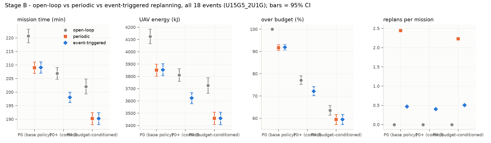

# edr — Energy-constrained UAV–UGV routing under dynamic roads

Implementation of the project in `../context/RM_IIT2024036_IIT2024081_IIT2024146 (1).pdf`
(*Energy-Constrained UAV–UGV Replanning under Dynamic Road Conditions*), built on the base paper
`../context/p1.pdf` (Mondal et al., arXiv:2504.21111). **Not** the friend's project (learned virtual-slot
assignment); the UAV→UGV assignment here is the base paper's frozen greedy rule.

Units: km, min, kJ. Everything below was run on a CPU-only laptop (12 cores, no GPU).

## What is implemented

| Deck element | Where |
|---|---|
| Base environment: sortie-wise UAV/UGV switching, fuel mask, greedy UAV→UGV assignment, one UAV per UGV, `T_R`, penalty | `src/edr/env.py` |
| UAV power model `P(v)`, battery 287.7 kJ, speeds | `src/edr/params.py` |
| Mission energy `E = Σ P_fly·t_fly + P_wait·t_wait`, budget `B = β·B0` | `env.py`, `evaluate.py` |
| Road model: normal / slow (×κ) / blocked edges; events by type × level × timing; "policy learns only when it occurs" | `roads.py`, `events.py` |
| Road graph **with loops** (so a blockage has a detour) + a branching tree for the base check | `roads.py` |
| Transformer encoder–decoder policy (3-layer 8-head encoder, context vector, glimpse, clipped scores, masks) | `model.py` |
| Candidate B: remaining-budget input `b_t` | `model.py` (`use_budget`) |
| REINFORCE with greedy-rollout baseline (paper Alg. 1) and group-baseline fine-tuning | `rl.py` |
| P0 base · P1 route filter · P2 fixed penalty · P3 Lagrangian (candidate A, dual ascent) · P4 budget-conditioned (candidate B) | `rl.py`, `evaluate.py`, `scripts/train.py` |
| Dynamic road layer: reachability + "on-time" action masks on the current roads | `env.py` (`road_aware`, `projected_wait`) |
| Open-loop / periodic / event-triggered replanning (keep completed route, replan the rest) | `plan.py` |
| Hand-checkable 1U-1G, 3-task case; `E = ΣP·t`; hover vs landed waiting | `tests/test_env.py` |
| Ablations: remove budget input, fixed vs Lagrangian, none/periodic/event, train with/without road events, Euclid vs road assignment | `scripts/experiments.py` |
| Stages A (static budgets), B (blocked/slow roads), stress test (disconnecting block), M1 trend check | `scripts/experiments.py`, `scripts/validate_m1.py` |
| Demonstration simulation (open-loop vs event-triggered, same instance and event) | 2D video: `scripts/make_animation.py`, `src/edr/viz.py`; **3D browser viewer** (Three.js, 4 scenarios): `scripts/export_viewer_data.py` → `scripts/build_viewer.py` → `viewer/index.html` (self-contained, open it directly in a browser) |
| Physics replay of the planned missions in Gazebo Harmonic (wheeled UGV, real-terrain heightmap, headless, MP4) | `gazebo/` (see `gazebo/README.md`) |
| Runnable 3D Gazebo demo (close-up models, real time, optional real terrain), one command | `gazebo/demo/`, package `gazebo/gazebo_demo.zip` |

## Maps

`paper` (the base paper's exact road, reconstructed from the authors' code), `loop` (our first map; all results above), `grid`, `radial`, `geo`, and `border`
(army border surveillance: patrol road, supply road, connectors, forward outposts, surveillance strip). `results/maps.png` draws them; `results/map_study.csv`
compares how much events matter on each (rule-based policy: `border` most, `radial` least). Select with `--roads <name>`; model/result folders carry the map name.

## Run on Kaggle (heavy training)

```bash
.venv/bin/python scripts/package_for_kaggle.py --user vichanshur        # builds kaggle/ (nothing is uploaded)
kaggle datasets create -p kaggle/dataset                                # private dataset with the code
kaggle kernels push -p kaggle/kernels/edr-border                        # one kernel per map; 2 at a time is typical
kaggle kernels status vichanshur/edr-border
kaggle kernels output vichanshur/edr-border -p out/border               # results_bundle.zip
```

Each kernel trains P0 + 6 variants x 3 seeds for its map and runs Stages A, B, S (resumable; CPU, no internet needed).

## Run

```bash
cd implementation
.venv/bin/python -m pytest                                   # 29 tests
.venv/bin/python scripts/train.py p0 --uav 2 --ugv 1         # imitation warm start + REINFORCE
.venv/bin/python scripts/train.py ft --uav 2 --ugv 1 --variant p0c --variant p2 --variant p3_b90 --variant p4 ...
.venv/bin/python scripts/experiments.py A|B|S --uav 2 --ugv 1 --n 100
.venv/bin/python scripts/make_figures.py --tag U15G5_2U1G && .venv/bin/python scripts/make_report.py
.venv/bin/python scripts/make_animation.py --kind slow --level high --timing early --gif
```

Outputs: `results/REPORT.md` (all tables with 95 % CIs and paired differences), `results/<tag>/figures/*.png`,
`results/<tag>/media/mission_*.{mp4,gif,png}` (the simulation), `results/validation/m1_trends.csv`,
`results/<tag>/stage*.csv` (raw per-instance rows), `results/logs/` (training logs), `results/models/` (checkpoints,
training curves).

## Results (U15G5, 100 held-out instances; the sections below are one training seed unless marked multi-seed; ± = 95 % CI)

### Multi-seed, multi-map confirmation (Kaggle, 3 training seeds x 4 maps; `results_kaggle/`, `REPORT_SEEDS_*.md`)

Each map was trained from scratch for 3 seeds (800 imitation + 1200 REINFORCE steps, then 600-step fine-tuning per variant), 2U-1G, hover waiting, 100 test instances,
18 road events. Numbers are paired **within each seed**, then averaged over seeds (± = 95 % CI over 3 seeds, 2 dof, so intervals are wide; per-seed values are in the reports).

| question | ring-road | border | geo | paper (tree) |
|---|---|---|---|---|
| Road layer + event-triggered replanning vs open loop, dT (min) | -18 [-10,-12,-33] | -15 [-13,-23,-10] | -41 [-23,-19,-82] | -15 [-17,-17,-12] |
| ... dE (kJ) | -420 | -264 | -1022 | -348 |
| Event-triggered vs periodic replanning, dT (min) | +0.2 ± 0.3 | +0.1 ± 0.2 | 0.0 ± 0.1 | 0.0 ± 0.3 |
| ... replans per mission | -2.3 | -0.9 | -2.7 | -2.0 |
| P4 (budget-conditioned) minus P0+ control, dT (min) | +0.1 ± 13 | -3.1 ± 17 | -7.1 ± 20 | -4.4 ± 26 |
| P3 (Lagrangian) minus P0+ control, dT (min) | +4.4 ± 18 | -1.0 ± 6 | -4.9 ± 35 | +5.0 ± 41 |
| P1 route filter minus P0+ control, dT (min) | -32 ± 20 | -33 ± 16 | -99 ± 104 | -47 ± 7 |
| ... dE (kJ) | -836 | -863 | -2536 | -1153 |

* **Robust across all 12 (map, seed) combinations:** replanning with the road layer beats open loop (the sign is negative in every one of the 12), and event-triggered replanning
  matches periodic replanning (|dT| <= 0.3 min) with 1-3 fewer replans per mission (H3, H4).
* **Not supported:** P3 and P4 are not distinguishable from the equally-trained P0+ control on any map (all CIs contain 0): H2 and the candidate-method claims are **not shown**.
* **P1 (sampling + budget filter) is the strongest method on every map.** On the geo map its CI contains 0 only because seed 2's base policy is weak.
* **Weak seed:** training seed 2 gave a poor base policy on the loop and geo maps (ring-road static mission time 287 min vs 186 for the other two seeds; geo map with road events 565 min vs 309-318) even with the extra-imitation safeguard.
  That seed inflates the intervals; it is reported, not dropped.
* **Landed waiting (border, energy counts flight only):** now the energy can be reduced without slowing the mission: P1 saves -128 ± 49 kJ (~13 %) at +2.8 ± 10 min. P3/P4 still show no clear effect (-28 and -24 kJ, intervals contain 0).
* **M2 (lambda converges), with lambda driven by the greedy validation violation (`p3g_*`):** at beta = 1.0 and 0.95 lambda stabilises (std 0.18 over the last 10 epochs, at 3.4 and 5.6) with a residual greedy violation of +6-7 % of B0;
  at beta = 0.9 it saturates at its cap (8): that budget is out of reach for this policy class. So M2 is **partly met**.
* **Stage C (zero-shot U45G15, loop, 2U-1G, 50 instances, 1 seed):** same pattern: P0 349 min; P1 304 min; open loop 401 -> event-triggered 381 min.

### The idea from the mid-sem deck, tested: "a bit more time saves a lot of energy" (`scripts/tradeoff_study.py`, `scripts/jit_study.py`)

* **At the route level it is not achieved.** The mid-sem illustration (slide 6: +3 % time -> -26.7 % energy) used made-up numbers. Measured on our model, the lowest-energy route is only 0.7 % slower and saves 0.9 % energy under hover waiting (time and energy correlate 0.96); with free waiting it costs +23 % time for -7.9 % energy. Slowing the UAV does not help either: energy per km is 19.9 kJ/km at 10 m/s and 15.1 kJ/km at 15 m/s in the base paper's power model.
* **At the scheduling level it is achieved: just-in-time departure** (`env.jit`). A UAV that expects to reach the rendezvous before the UGV delays its take-off by the expected wait and waits on the ground (free) instead of hovering. Base policy P0, 4 maps x 3 seeds, 60 instances: **53-74 % less UAV energy with the mission time unchanged (+0.00 min)**; with road events 54-70 % (the planner only knows the delays it can predict from its believed road state; 11-36 % of the energy is still unforeseen hovering). Share of instances over the budget 0.9 B0: 75-100 % -> 0 % on static roads, 0-4 % with events.
* **Assumptions to state honestly:** a UAV can wait on the ground at its charging point at no energy cost; the UGV is the bottleneck so the delay does not slow the mission; waiting energy is our accounting choice (hover 229.6 W, assumption 3 in context.md). This is an execution-time rule on top of any route policy, not something that was learned.

### Closing the loose ends (Kaggle: 3 more team sizes, long training, distillation, lambda; local: Stage C, baselines, sampling)

* **Other team sizes (loop map, 3 seeds each; `results_kaggle/loop-1u1g|2u2g|4u2g`):** replanning with the road layer beats open loop for every team (1U-1G -2.9 min, 2U-2G -11.9, 4U-2G -18.6; 2U-1G -18 from before). It is smallest with one UAV (the UGV is rarely the bottleneck).
  Event-triggered = periodic (|dT| <= 0.8 min) with 1-4 fewer replans per mission (1U-1G: 4.7 vs 0.6). P3/P4 are again indistinguishable from the control (all CIs contain 0). P1 (sampling + filter) beats the control by 18 / 26 / 49 min.
* **Stage C, larger instances (zero-shot, loop map, 2U-1G, 50 instances, 3 seeds; `results_stageC/`):** at 45 and 75 tasks the same ordering holds (open loop > event-triggered > sampling + filter), but one of the three seeds is a **bad base policy, not a size effect**: it already loops forever (hits the round cap) in 5 of 30 instances at the training size (15 tasks: mean 892 min vs 192 for the other seeds), and in 5 of 30 at 45 tasks (mean 1343 vs ~352). The other two seeds give ~360 min at 45 tasks and ~470 at 75. Median-seed numbers: 45 tasks greedy ~360 -> filter ~315; 75 tasks ~480 -> ~440.
* **Base policy gap (paper map, 4U-2G):** 3000 REINFORCE steps x 3 seeds give 214.9 / 211.1 / 206.5 min (was 219.0): **still 9-14 % above the paper's greedy 188.9**; more training at this scale does not close the gap.
* **Sampled decoding (paper map, 100 instances, best of 1024; `scripts/sampling_eval.py`):** 199.5 / 160.2 / 138.5 / 140.7 min for 1U-1G / 2U-1G / 2U-2G / 4U-2G vs paper DRL(1024) 220.4 / 203.1 / 157.1 / 165.6. Our map and instances are reconstructions, so this is not a claim to beat the paper. **Best of 10,240** (Kaggle kernel `edr-sampling10240`, 50 instances, `results/sampling_eval_10240.csv`): 197.5 / 157.2 / 135.3 / 135.2 min vs paper DRL(10240) 218.6 / 199.7 / 154.4 / 159.9, i.e. 10 to 15 % lower than the paper's number for the same sample budget; more samples than 1024 gain only 1 to 4 % (4U-2G 140.7 -> 135.2).
* **GLS / Tabu / SA baselines (`src/edr/bilevel.py`, `scripts/bilevel_eval.py`; paper map, 100 instances, 3-4 failures excluded):** our OR-Tools bilevel pipeline (min set cover -> stop-order TSP -> capacity-constrained UAV sorties, executed in our simulator) gives GLS 279 / 208 / 198 / 175 min vs the paper's 281.7 / 232.8 / 188.3 / 219.7: close for 1U-1G, +-10-20 % otherwise, so the same ballpark, not an exact reproduction. GLS, Tabu and SA differ by < 1 % here.
* **Lambda (M2) with the cap raised to 50 and 1500 steps (`p3h_*`, greedy-validation-driven):** lambda now **settles** instead of hitting the cap: ~5.1 (std 0.15) at beta = 1.0 (residual violation +0.03) and ~13.4 (std 0.5) at beta = 0.9 (residual violation +0.16: the budget is still not met). M2's "lambda converges" criterion is met; the 0.9 budget is infeasible for the greedy policy.
* **Candidates A/B fix attempt - search distillation (`expert_iteration`, variants bon_t / bon_nb / bon_p4x):** the best of 32 sampled routes is ~25 % faster than the average sample (elite T 130-155 vs 170-200 min), but imitating it did **not** transfer: greedy validation time stays between 182 and 240 min and ends no better than the control (all variants T = 218.6-220.4 vs control 220.2; budget-aware equals budget-blind). Negative result; checkpoint selection was not tried.
* **Gazebo:** plans are replayed in Gazebo Harmonic (see `gazebo/README.md`); the learned policy itself is not run inside Gazebo. Done since: 10240-sample decoding, loop-detection fallback for the bad seed.

**M1 – base comparison on the paper's own map.** Mean mission time, static roads, 100 instances (min). `paper` = the base paper's exact road
(reconstructed from the authors' code). Ours: 600 imitation + 400 REINFORCE steps, then 1500 more REINFORCE steps (group baseline), CPU only:

| | 1U-1G | 2U-1G | 2U-2G | 4U-2G |
|---|---|---|---|---|
| paper DRL (greedy) | 238.2 | 229.7 | 180.5 | 188.9 |
| paper DRL (10240 samples) | 218.6 | 199.7 | 154.4 | 159.9 |
| ours, rule, paper map | 271.9 | 245.5 | 202.1 | 215.5 |
| ours, trained P0 greedy, paper map, short training | 271.2 | 254.8 | 201.5 | 225.7 |
| **ours, trained P0 greedy, paper map, +1500 steps** | **228.1 ± 37** | **209.8 ± 42** | **185.1 ± 43** | **219.0 ± 59** |

After the extra training our greedy policy is within about 10 % of the paper's greedy DRL for three of four teams (1U-1G −4 %, 2U-1G −9 %, 2U-2G +3 %) and the
team ordering matches; **4U-2G is still +16 %** (our P0 does not exploit four UAVs). With 10,240 samples our policy gets 197.5 / 157.2 / 135.3 / 135.2 min, below the paper's sampled column (our map and instances are reconstructions, so this is indicative only).
Standard deviations are ±37-59 min over instances, so the 1U-1G, 2U-1G and 2U-2G differences are within noise. Zero-shot on the larger U45G15 size (loop map, 2U-1G) our P0 takes ≈ 349 min (paper greedy 339).

**Hypotheses** (2U-1G; 2U-2G in `results/REPORT.md`):

* **H3 supported (time/energy).** Open-loop base policy, event vs same instance on static roads: block +14…18 % T / +20…27 % E;
  slow low→high +3→18 % T / +4.5→25 % E; early events cost most (+29 % E) and late ones least (+6.6 %).
  Failures stay ≈0 while the road stays connected; they only appear when a bridge is cut (below).
* **H4 supported.** Event-triggered vs periodic replanning, same policy and events: ΔT = +0.1 ± 0.1 min (P0), 0.0 (P4);
  replans 0.47 vs 2.45. Road layer + event-triggered replanning vs open loop: −11.6 ± 1.0 min and −271 ± 24 kJ (−6.6 %) for P0.
* **H1 not supported as stated.** In this environment time and energy move together: faster routes wait less, so they also
  use less energy (P1 route filter: −19 % T *and* −25 % E vs greedy P0). There is no visible trade-off to exploit; min-time and
  min-energy routes nearly coincide (P1 at β=0.7 vs 1.0 differ by 20 kJ). The deck lists this as a risk.
* **H2 not supported / inconclusive.** P3 (Lagrangian) vs P2 (fixed penalty) are not distinguishable (β=0.9: 53 % vs 62 % over
  budget, paired ΔT, ΔE CIs include 0), and λ **saturated at its cap (8)** for β=0.8 and 0.9: the policy never became
  feasible, so "λ converges" (M2 exit criterion) was **not** met. β=0.7 is out of reach for every learned policy.
* **Candidate methods vs the P0+ control** (same extra fine-tuning, road layer + event-triggered, Stage B 2U-1G):
  P4 −7.8 ± 2.0 min / −165 ± 49 kJ, P3 −7.9 / −214 kJ. On 2U-2G only P3 beats the control and P4 does not (+0.1 ± 5.8 min in Stage A).
  Because there is **one training seed**, these differences cannot be separated from training-seed variance.
* **Budget input ablation:** P4 vs P4 without the budget input: no clear difference (Stage A over-budget 53 % vs 60 % at β=0.9, 2U-1G).
* **Training with road events** (P4_ev, P0_ev) was not better than static training (T 193 vs 190 min).
* **Euclid vs road distance for assignment** (2U-2G): no significant effect (dT −0.4…+1.8 ± ≥0.9 min). With one UGV it is trivially identical.
* **P1 (route filter) is the strongest method by a wide margin** (T 157 vs 189, E 2585 vs 3350 for the control; over-budget 20 % at β=0.9,
  0 % at 1.0) — it is search at inference time (64 samples/instance), i.e. it spends compute the learned policies are meant to amortise.
  Our learned policies, trained for minutes on a CPU, do not close that gap (the paper's own sampling-vs-greedy gap is ~12 %; ours is 19 %).
* **Stress test (disconnecting bridge):** failure 85 % → 68 % (P0, open → event-triggered, 2U-1G) and 75 % → 52 % (2U-2G). Most failures are
  unavoidable because UAVs have just committed nearly empty batteries; diversion needs spare fuel. A fuel reserve policy is future work.



### Loop-detection fallback and JIT across team sizes (`scripts/fallback_study.py`, `scripts/jit_teams.py`)

* **Fallback.** `env.stalled_rounds` counts rounds with no progress (no new task visited); `NeuralPolicy(fallback=True)` hands over to the nearest-feasible rule after 2 such rounds. Zero-shot, loop map, 2U-1G, 30 instances per size and seed (`results/fallback_study.csv`):
  good seeds 0 and 1 are **identical with and without the fallback** (it never triggers), except that seed 1 at 75 tasks keeps 1 failure; the bad seed 2 goes from 5/5/6 failures (15/45/75 tasks) to **0/0/0**, and mean time 892 -> 302 min (15 tasks), 1343 -> 749 (45), 1694 -> 1162 (75). It removes failures but the seed stays about 2x slower than the others (a bad policy, not a bug), so the fix for it is picking a better seed, not the fallback.
* **JIT across team sizes** (loop map, 60 instances, base policy + road layer, event-triggered; `results/jit_teams.csv`). Mission time is unchanged (+0.00 min) in every case:

  | team | energy, static roads | energy, with 18 events | over budget (0.9 B0), events |
  |---|---|---|---|
  | 1U-1G | -9.5 % | -18.0 % | 99 -> 68 % |
  | 2U-1G | -53.0 % | -54.0 % | 88 -> 1 % |
  | 2U-2G | -38.1 % | -39.8 % | 87 -> 8 % |
  | 4U-2G | -69.9 % | -69.2 % | 76 -> 0 % |

  The saving follows how long UAVs wait; with one UAV the UGV is rarely a bottleneck, so there is little to save. With sampling + budget filter (P1, 2U-1G, static): -0.83 min and -46.2 % energy, over budget 31 -> 0 %.
* **10,240-sample decoding:** see the sampled-decoding bullet above (`results/sampling_eval_10240.csv`).

### More training for 4U-2G did not help (Kaggle `edr-4u2g-more`)

3000 more REINFORCE steps (paper map, 3 seeds, greedy T on 100 instances; before -> after): seed 0 214.9 -> 208.2, seed 1 211.1 -> 213.7, seed 2 206.5 -> 207.3 min; mean 210.8 -> 209.7 min vs the paper's greedy 188.9. The gap to the paper's greedy decoding stays ~11 %; sampled decoding (best of 10,240: 135 min vs the paper's 160) is what closes it.

### Headline: sampling + budget filter + just-in-time departure, and what was tuned (`scripts/jit_p1_maps.py`, `jit_refine_study.py`, `adaptive_sampling.py`)

* **P1 + JIT on 4 maps x 3 seeds** (2U-1G, Kaggle base policies, 24 instances per map/seed, budget 0.9 B0; `results/jit_p1_maps.csv`; mean over the 12 map-seed pairs, no failures):

  | | static roads: T (min) / E (kJ) / over budget | 4 road events: T / E / over budget |
  |---|---|---|
  | base policy | 228.0 / 4407 / 78 % | 270.0 / 5531 / 91 % |
  | base + JIT | 228.0 / 1562 / 0 % | 270.0 / 1971 / 1 % |
  | sampling + budget filter (64 samples) | 182.8 / 3248 / 16 % | 206.0 / 3849 / 40 % |
  | **sampling + filter + JIT** | **182.3 / 1524 / 0 %** | **205.3 / 1841 / 2 %** |

  So the combination is 20 % faster, 65 % less UAV energy, and fits the budget (per map: loop 210 -> 175 min and 3770 -> 1676 kJ; paper 199 -> 168 / 3624 -> 1530; border 150 -> 122 / 2832 -> 954; geo 353 -> 264 / 7401 -> 1937, static roads). JIT's energy saving assumes UAVs can wait on the ground at no cost (see caveats above).
* **JIT with re-prediction at takeoff** (`env.jit_refine`; the UAV re-checks the UGV's arrival with the roads known when it actually takes off, so events that happen during the ground wait are included). Base policy, event-triggered, 2U-1G, 4 maps x 2 seeds x 18 events (`results/jit_refine.csv`): hover energy 3070 kJ (no JIT) -> 241 (JIT) -> **80** (re-predicted); total energy 4480 -> 1651 -> **1490** kJ; time unchanged (226.2 min); over budget 85 % -> 1 % -> 0 %.
* **Adaptive number of samples** (`route_filter_planner(adaptive=True)`: samples in chunks of 16 and stops when a route fits the budget and two chunks improved the best time by < 1 %). Result: **neutral**. With JIT the budget is rarely tight, so it stops at ~61 samples and matches fixed-64 (T 182.6 vs 182.3 static; 210.8 vs 211.6 events). The useful finding is the samples-quality curve (static / events): 16 samples 190.8 / 223.8 min, 64: 182.3 / 211.6, 256: 174.0 / 199.5, i.e. about -4 to -5 % time per 4x samples at 4x the planning cost (0.9 s, 2.7 s, 9.7 s per batch of 24). A tighter stopping rule or a bigger sample cap is the lever, not adaptivity.

## Energy trade-off diagnostic (why H1/H2 do not show up) — `scripts/tradeoff_study.py`

60 instances x 128 sampled routes from P0 (loop map, 2U-1G). Per instance, the lowest-energy route vs the fastest route:

| energy model | corr(T, E) | lowest-E route: extra time | energy it saves | Pareto routes |
|---|---|---|---|---|
| hover waiting (as modelled, 229.6 W) | 0.96 | +0.7 % | 0.9 % | 1.4 |
| hover power x 0.5 | 0.97 | +0.3 % | 0.6 % | 1.4 |
| hover power x 0.25 | 0.90 | +2.1 % | 1.2 % | 1.8 |
| **landed waiting (free)** | **0.39** | **+23.2 %** | **7.9 %** | 3.8 |

* With hover waiting, time and energy are almost the same objective: there is nothing to trade, so an energy-aware method cannot beat a time-optimal one by much. A real trade-off appears only when waiting is free, and then it is expensive (about +3 % time per 1 % energy).
* Stage A re-run under landed waiting (`--wait-mode landed`, models in `results/models/U15G5_2U1G_landed`, 100 instances): P0 greedy E = 1553 kJ; **P1 route filter** moves along a visible Pareto curve (beta 1.0: T 164 / E 1454; beta 0.9: T 176 / E 1399; beta 0.8: T 184 / E 1376, over-budget 0 % / 47 % / 89 %); the learned P2, P3, P4 (T 181-190, E 1427-1506) are not better than the P0+ control (T 178, E 1440).
* **Finding about candidate B (budget-conditioned P4):** its output is identical for every beta. The learned weight on the budget input is ~10x smaller than on the other inputs (0.005 vs 0.053). A variant with a "pace" feature (remaining budget minus remaining work) and 10x learning rate on it (`p4x`, weights now 0.095) is still beta-independent after 600 steps. So at this training scale the policy does not use the budget; the energy lever is too weak to learn.
* Consequence: report H1/H2 honestly as "not supported under hover waiting; a small, costly trade-off exists only with free waiting", and treat search (P1) as the method that actually meets budgets.

## Deviations from the base paper / deck, and assumptions (please read)

1. **Training scale.** Paper: 5.12 M instances on an RTX 4090. Ours: CPU, ~600 imitation + 400 REINFORCE steps (batch 64) for P0 and
   200–400 fine-tuning steps per variant (group baseline, 8 samples/instance, lr 3e-4, advantage standardisation). P0 is warm-started by
   behaviour-cloning a nearest-feasible rule. The first fine-tuning attempt with the paper's greedy baseline for 200 steps barely moved the
   policy (E −1…−5 %; kept in `results/models/U15G5_2U1G/v1_greedy_baseline/`), hence the group baseline.
2. **One training seed**, not three (deck: 3). CIs are over test instances only.
3. **Decoder** adds two dynamic geometry features (distance from current position; for landings, distance to nearest unvisited task) and uses
   **LayerNorm** instead of BatchNorm (BN in eval mode misbehaved at batch size 1). Encoder otherwise as in the paper.
4. **`T_R = 15 min`**, road geometry, depot choice, UGV service order (earliest touchdown first) are assumptions — not stated in the paper text.
5. **Waiting energy:** hover waiting is charged to mission energy `E` at `P(0) = 229.6 W`; the per-sortie battery constraint `F_a` covers flight only
   (as in the base paper). A `landed` wait mode (0 W) exists for the unit test. Hover waiting is ~40–70 % of `E`, which is why time and energy are so aligned.
6. **Replanning happens at round boundaries** (completed route kept). Mid-round, a UAV whose rendezvous is cut off may *divert* on its remaining
   battery (enabled for periodic/event, not open-loop).
7. **P4's loss** is not specified in the deck; we use a fixed hinge `κ·T_ref·(E−B)₊/B0`, κ = 3. P3 uses dual ascent with step 0.1, cap 8.
   `t_ref` (scale only) is the mean P0 validation time, inflated by one failed instance (269 min for 2U-1G).
8. **B0** is P0's greedy energy on the same static instance (instances where P0 itself fails are skipped in the test set; in training the rule-based run is used).
9. **Test events** are placed on the UGV's upcoming drive in the base policy's static run, so every event bites; "blocked" events keep the graph connected except in the stress test.
10. Metaheuristic baselines (GLS/TS/SA with OR-Tools) and Stage C (larger sizes) are implemented (see the sections above). Gazebo: the planned missions are replayed in physics (`gazebo/`), but the learned policy is not run inside Gazebo and UAV flight is kinematic.
